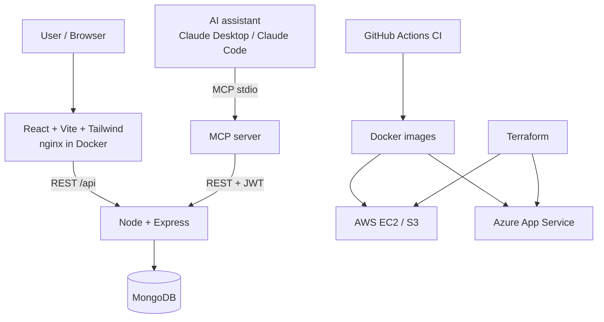

# Architecture

## Key design decisions
- **RBAC at the route layer**: `protect` (JWT) then `authorize(...roles)`. EMPLOYEE users are additionally scoped in the controller to assets assigned to their linked Employee record.
- **Asset state machine**: `AVAILABLE -> ASSIGNED -> (transfer) -> AVAILABLE`, `* -> MAINTENANCE -> back`, `AVAILABLE -> RETIRED`. Illegal transitions return 409.
- **Audit log**: every create/update/assign/transfer/return/maintenance/delete writes an append-only `AssetHistory` row (asset code is denormalised so it survives deletion).
- **MCP server uses the REST API**, not the database, so permissions and validation are never bypassed.
- **Validation** with zod on every write endpoint; one error handler returns `{ message, errors[] }`.
